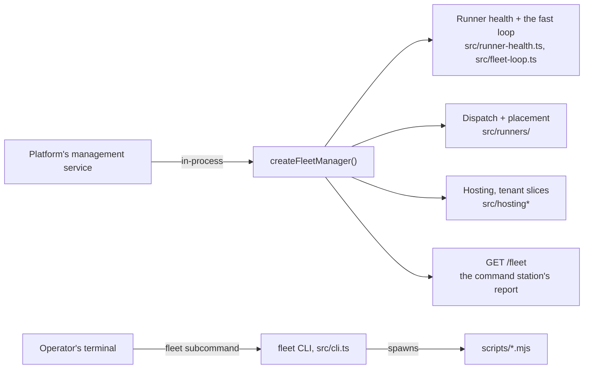

# Contributing

How to run, change and ship Fleet Manager. What it does for the operator is
in [features.md](features.md). Read [`AGENTS.md`](../../AGENTS.md) before
touching the fleet; it is long because it records every rule that fails
silently when broken, each with the measurement that taught it.

## Run it

```sh
pnpm install
pnpm run check       # format:check + lint + typecheck + build + check:exports + test
pnpm run lint:types  # type-aware ESLint — NOT covered by plain `lint`
```

Read `pnpm run check`'s **exit code**, not its output — a filtered-output
check once let a red build publish because two warning lines scrolled past a
`tail`. `cmd | tail` reports `tail`'s exit code, not `cmd`'s, which is
exactly how that happened. There is no `.env`: production secrets come from
the platform's own vault broker through its PM2 wrapper, resolved from
`.devvault.local.json` (gitignored) from the repo root.

**Work in a git worktree**, never the main checkout, and never run a fleet
command from the main checkout that touches a real node. This package's own
tests use fixture node names (`claw-fixture` and the like) specifically so a
test can never match a real machine by accident.

## How it fits together



- **One door, subcommands.** `src/cli.ts` assembles `COMMANDS` from five
  domain modules (`cli-commands-fleet-ops.ts`, `-hosting.ts`, `-gates.ts`,
  `-lifecycle.ts`, `-onboarding.ts`). Each subcommand **spawns** its script
  rather than importing it, so the script's own argv parsing and exit code
  pass through untouched — several automated jobs parse this CLI's stdout as
  JSON and read a non-zero exit as a finding, not a crash.
- **Layers.** Every non-test file under `src/` and `scripts/` sits in one
  layer of a fixed stack (composition → surfaces → domain → observation →
  automation → state → access → config). Imports point down the stack only.
  `scripts/lib/layer-map.json` is the placement data; a guard test checks it
  against the real import graph (`scripts/measure-layers.mjs`).
- **File size.** Every tracked source file has an 800-line ceiling, every
  test file 1,000, gated by `scripts/lib/file-size-guard.mjs` against a debt
  list that may only shrink (`134bae2` introduced it; dozens of files were
  split the same week to fit under it).
- **Manifests.** `manifests/` in this repo holds **test fixtures** of the
  live machine topology, not the live data — the real manifest the fleet
  reads in production is resolved through `FLEET_MANIFEST_DIR`, which
  defaults to a path inside the platform's own site checkout. Editing a
  fixture here changes nothing live.
- **The reader for a facet may not read what the writer wrote.** Capacity
  limits are read from the kernel, not from the config that declared them;
  registrations are read from the GitHub API, not from a local record. A
  verifier that reads its own writer's artifact cannot fail, which is the
  whole point of keeping the two apart.

## Tests and gates

```sh
pnpm run test        # node:test, source + scripts
pnpm run check       # the full gate CI runs
```

- **`check-public-history.mjs`** and **`publish-safety-guard.test.mjs`**
  fail the build if any tracked file carries a private address, a denylisted
  term, or anything under `docs/planning/` (which is a gitignored symlink
  into the private companion repo locally, and must never be tracked here).
- **`json-contract-declaration.test.mjs`** parses the `--json` contract
  table straight out of the README and fails the build if it drifts from the
  table declared in `scripts/lib/json-contract.mjs` — a hand-kept copy of
  that list has gone stale three times before this test existed.
- **Every test is reported.** `pnpm run test` writes JUnit beside its
  console output, `reports/node-test.xml` (source) and
  `reports/node-test-scripts.xml` (scripts), and CI's `check` and the publish
  job's verify post both, red runs too, to the fleet test store through
  `WolffM/hadoku-actions/report-tests` (suites `unit` and `publish`;
  advisory, it never fails the job). The two reports are ~1.7 MB together
  for ~7,000 tests, ~230 KB gzipped as posted.
- **The CI job must stay named `check`.** Renaming it breaks every PR's
  required status forever.
- **Never `runs-on: ubuntu-latest`.** Workflows read the fleet's own runner
  label from a repo variable this package itself keeps current; setting it
  by hand gets reverted within ten minutes.

## How it ships

Push to **`ppe`**, never to `main` — `main`'s own branch rules refuse a
direct push, and a hotfix straight to it is the operator's call, not an
agent's (`a56eba3`). An agent that needs `main` moved now forces a promotion
of a green `ppe` commit, or asks the operator to run the hotfix tool; the
ladder is in `AGENTS.md`, "When `main` has to move now". CI runs on every `ppe` push; a promotion workflow then
fast-forwards `main` to the newest green `ppe` commit on a timer, or sooner
on request. A red push on `ppe` is reverted automatically and an issue is
filed naming the session that made it. The package's version is set at
publish time (the registry's newest plus one patch) and is never hand-edited
in a commit.

Publishing to GitHub Packages happens on every version bump. The platform's
own management service installs the new version on its own deploy cycle —
a push here does not, by itself, restart anything that is running it.
The published package carries a one-line README that links back here: the
registry copies each version's README into the package's metadata, and every
install that resolves the package downloads that metadata whole.

## Trivia

`pnpm lint` runs only the cheap, syntactic ESLint rules; the type-aware set
that catches real async bugs runs only under `pnpm run lint:types`, a
separate command a green plain `lint` gives no hint is needed.
